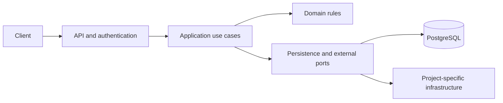

# ParcelRelay — Backend Developer Track

**Project 3 of 8 · Java 21 · Spring Boot 3.5.16 · Maven 3.9.9 · PostgreSQL**

> Start with [Getting Started](docs/GETTING_STARTED.md), then [Submission Rules](docs/SUBMISSION_RULES.md). The complete rules are below; milestone checklists point back here.

## 1. Overview

Build **ParcelRelay**, a backend for **reliable shipment workflows and signed webhooks**. You implement the application, data model, API and failure handling. The learning focus is: REST integration, signed webhooks, RabbitMQ, transactional outbox/inbox, at-least-once delivery, retry budgets, circuit breakers, dead-letter queues, tracing.

This is original learning material organized like the supplied `substream.zip`: numbered specification, stable business-rule IDs, M1–M3 shared milestones, D4–D7 developer milestones, an AQA guide and reflection. It is not connected to the SubStream/NIX grading bot. The reference project is [SubStream](https://github.com/Abd-Elrahman3/SubStream-Developer-Track); no completed solutions or proprietary bot are included.

## 2. How the Challenge Works

### 2.1 Milestones

Do projects in order. Prerequisite: complete D7 of [SeatLock](https://github.com/Abd-Elrahman3/seatlock-spring-boot) and explain its failure drills.
Every milestone is required. Advanced requirements are part of completion, not optional stretch goals. M1–M3 establish the model, database and transactions; D4–D7 add contracts, difficult behavior, failure recovery and operation.

| Milestone | Goal | Branch | Guide |
| --- | --- | --- | --- |
| M1 | Domain and invariants | `feature/m1-domain` | [Shared](docs/SHARED_MILESTONES.md) |
| M2 | Database and persistence | `feature/m2-database` | [Shared](docs/SHARED_MILESTONES.md) |
| M3 | Transactional use cases | `feature/m3-transactions` | [Shared](docs/SHARED_MILESTONES.md) |
| D4 | API contracts and authorization | `feature/d4-api` | [Developer](docs/TRACK_DEVELOPER.md) |
| D5 | Advanced behavior and resource limits | `feature/d5-advanced` | [Developer](docs/TRACK_DEVELOPER.md) |
| D6 | Failure testing and recovery | `feature/d6-failures` | [Developer](docs/TRACK_DEVELOPER.md) |
| D7 | Operations and design defense | `feature/d7-operations` | [Developer](docs/TRACK_DEVELOPER.md) |

### 2.2 Levels

Bronze = M2; Silver = D4; Gold = D6; Platinum = D7 **with evidence**. Complete Platinum before progressing to the next project. A blocked feature should get a smaller reproducible experiment; do not mark it complete by removing its assertion.

### 2.3 How your work is evaluated

The starter compiles and runs only packaging tests by default. Behavioral examples and test exercises intentionally fail. `python3 scripts/check_progress.py --through M1` runs the cumulative milestone tests and checks evidence; advance through D7. The workflow runs this gate on milestone PR branches. A green starter build proves packaging only.

Automation is a guardrail, not proof of understanding. You own these repositories and can bypass local checks; keep the gates intact, review tests and explain tradeoffs aloud. There is no hidden evaluator and branch protection is not configured by these files.

## 3. Architecture



The API binds and validates transport input. The service establishes authorization and transaction boundaries. Domain objects enforce state rules. Persistence adapters map database data without leaking entities to API responses. Dependencies and clocks are constructor-injected. Keep network calls outside long database transactions and record uncertain outcomes explicitly.

See [Database Requirements](docs/DATABASE_REQUIREMENTS.md), [API Requirements](docs/API_REQUIREMENTS.md) and [Architecture Decisions](docs/ARCHITECTURE_DECISIONS.md) for this project's concrete boundaries.

### 3.1 How the classes relate

| Area | Responsibility |
| --- | --- |
| domain | Shipment, OutboxEvent, DeliveryAttempt, InboxReceipt |
| service | Use cases, transaction boundary and principal-derived identity |
| repository / persistence | Ports, SQL/JPA/R2DBC mappings, constraints and query strategy |
| api | DTOs, controllers/resolvers, validation and error mapping |
| advanced | Required project-specific workers, policies and adapters |
| config | Dependency injection, Clock, security, typed configuration |

## 4. Domain Model

| Type | Fields / types | Invariant |
| --- | --- | --- |
| Shipment | UUID id; String ownerSubject; String destination; ShipmentStatus status; long carrierSequence; long version | REQUESTED → DISPATCHED → IN_TRANSIT → DELIVERED; CANCELLED only before dispatch. |
| OutboxEvent | UUID id; UUID aggregateId; String type; int schemaVersion; String payload; Instant occurredAt; Instant publishedAt | Inserted in the same transaction as shipment state. |
| DeliveryAttempt | UUID id; UUID eventId; UUID endpointId; int attempt; Instant nextAttemptAt; String status | Unique(eventId,endpointId,attempt); durable retry state. |
| InboxReceipt | String consumer; UUID eventId; Instant processedAt | Unique(consumer,eventId); committed with consumer effects. |

Fields are private. Do not add public state setters to bypass business methods. A rejected domain operation changes nothing. IDs are UUIDs unless explicitly stated otherwise. Identity equality uses persistent ID; value objects use their values. Store timestamps as UTC `Instant`; use `LocalDate` only for calendar-date rules. Nullability is explicit in database/API specs; unknown IDs are never treated as empty success. Use `ConflictException` for invalid state transitions and `IllegalArgumentException` for invalid domain values. Constructor signatures in starter examples are stable; you may add overloads, private fields and new classes as requirements grow.

The declared fields and constructors are scaffolding; constructors and business methods throw `UnsupportedOperationException("TODO: ...")`. Getters, enum values, Clock and the application entry point are provided. See [Starter Map](docs/STARTER_MAP.md).

## 5. Business Rules

Rule IDs are local to this repository. Each rule includes a concrete acceptance example. Full behavior, boundaries and failures matter; the examples are a starting test set.

### M1 — Domain and invariants

#### BR-101 — Protect shipment transitions

No status regressions. DELIVERED and CANCELLED are terminal. Cancellation only from REQUESTED. Validate destination trimmed length 10..500. Unknown carrier status must be quarantined rather than coerced into success.

**Acceptance example:** IN_TRANSIT → DISPATCHED fails without changing the object; DELIVERED → CANCELLED fails.

#### BR-102 — Define event envelopes

Every event has eventId,aggregateId,type,schemaVersion=1,occurredAt UTC,correlationId,payload. Use stable event IDs across retries. Additive fields must be ignored by old consumers; unknown required event types go to quarantine.

**Acceptance example:** Replaying one event 10 times preserves eventId and business outcome; a v1 consumer tolerates an added optional field.


### M2 — Database and persistence

#### BR-201 — Write state and event atomically

Persist shipments and outbox_events in one PostgreSQL transaction. A process crash between state update and outbox insert must leave neither committed. Index unpublished outbox rows; claim with leases or SKIP LOCKED without holding locks during a slow broker call.

**Acceptance example:** Inject failure before commit: no shipment or event remains. Crash after commit: unpublished event is later recoverable.

#### BR-202 — Deduplicate consumers transactionally

Each consumer inserts inbox_receipts(consumer,event_id) in the same local DB transaction as its effects. Rabbit acknowledgment occurs after commit. Unique-key duplicate is treated as already processed.

**Acceptance example:** Crash after consumer commit but before broker ACK; redelivery creates no duplicate notification or shipment transition.


### M3 — Transactional use cases

#### BR-301 — Publish with confirms

Use durable RabbitMQ topology, persistent messages, publisher confirms and mandatory routing checks. Mark published only after positive confirm and successful routing. Lost confirmation permits republish; exactly-once delivery is not promised.

**Acceptance example:** Crash after broker acceptance before published_at update: duplicate appears and is safely deduplicated.

#### BR-302 — Integrate an unreliable carrier

Carrier create request uses shipment UUID as idempotency key. Configure connect timeout 1s and response timeout 2s; retry transient 429/5xx/timeouts at most 3 total attempts, honoring bounded Retry-After. Permanent 4xx are not retried. Persist UNKNOWN when timeout leaves the carrier result uncertain, then reconcile by key.

**Acceptance example:** Carrier accepted then timed out: reconciliation finds one shipment; no second external shipment is created.


### D4 — API contracts and authorization

#### BR-401 — Verify incoming webhook bytes

Signature header v1=<hex HMAC-SHA256(secret, timestamp + "." + exact raw request bytes)>; timestamp is Unix seconds. Require abs(now-timestamp)<=300s, constant-time comparison, max body 64KiB. Verify before JSON parsing or state changes. Support current and previous secret during rotation.

**Acceptance example:** Changing whitespace in a signed body invalidates the signature; stale, missing or malformed signatures return 401 and write nothing.

#### BR-402 — Apply ordered updates

Carrier payload contains eventId,shipmentId,sequence,status. Deduplicate eventId. Sequence <= last applied is acknowledged 200 as ignored; larger sequence may advance valid state, even across skipped intermediate states, but never regress or escape a terminal state. Impossible advances are durably quarantined and acknowledged.

**Acceptance example:** DELIVERED sequence 9 then IN_TRANSIT sequence 8 leaves DELIVERED. Duplicate sequence 9 produces no new outgoing event.


### D5 — Advanced behavior and resource limits

#### BR-501 — Deliver outbound webhooks durably

Clients register HTTPS endpoints on a deployment-owned hostname allowlist. Reject loopback/private/link-local resolved addresses and redirects; revalidate DNS at connection time. Use eventId as recipient dedup key and HMAC sign raw outbound bytes. A timeout is an uncertain outcome, eligible for retry.

**Acceptance example:** A DNS-rebinding endpoint and redirect to metadata IP are blocked; endpoint data never becomes an unrestricted server-side fetch.

#### BR-502 — Bound retries and isolate failures

Outbound delivery has 5 total attempts with delays 1s,5s,30s,120s plus bounded jitter. Retry 429,5xx,network errors; other 4xx → DEAD. Persist schedule, send without holding a DB transaction, and limit concurrent calls per endpoint to 4.

**Acceptance example:** Restart during backoff: next attempt remains scheduled. A failing endpoint does not block a healthy endpoint.


### D6 — Failure testing and recovery

#### BR-601 — Handle poison messages and replay

Consumer rejects malformed messages to a dead-letter queue after 3 processing attempts, without infinite requeue. Operations can inspect redacted failure details and replay after a fix. Replays retain original eventId; a new deliberate business action needs a new eventId.

**Acceptance example:** One poison message is dead-lettered while valid messages continue. Replay a fixed failure without duplicating already committed effects.

#### BR-602 — Use contract and failure tests

Use WireMock for carrier timeouts/signatures and Testcontainers for RabbitMQ+PostgreSQL. Test crashes at publish and ACK boundaries. Write a producer/consumer contract covering v1 event required fields and webhook signature bytes.

**Acceptance example:** A mutation that marks outbox published before confirm or ACKs before DB commit must fail the tests.


### D7 — Operations and design defense

#### BR-701 — Trace asynchronous work

Propagate correlation and trace context from HTTP through outbox, broker and worker. Metrics include oldest unpublished age, queue depth, dead letters and retry counts; no shipment IDs as metric labels.

**Acceptance example:** Trace one shipment end-to-end; alert when oldest unpublished age exceeds 60s for 5 minutes.

#### BR-702 — Recover from outages

Stop RabbitMQ for 2 minutes, accept shipments into the outbox, restore it and drain safely. Demonstrate secret rotation and failed-endpoint recovery. Document backlog sizing, retention (processed inbox 7 days) and replay horizons.

**Acceptance example:** No accepted shipment intent is lost; replaying events older than the dedup horizon requires an explicit reconciliation procedure.

## 6. Provided Infrastructure

Provided: pinned Maven build/wrapper, application entry point, UTC Clock bean, domain/API/repository/advanced stubs, Docker Compose, environment example, migration placeholder, API contract examples, packaging tests, intentionally red learning tests, CI and a cumulative gate. PostgreSQL migrations, business logic, authentication policy, transport handlers and behavior tests remain your work. Initial startup is not claimed until the required schema/configuration is implemented.

External providers must be mocked locally. No real payments, messages to customers or paid cloud accounts are needed. Install only the components required for the current milestone. See setup instructions for versions and ports.

## 7. Project Structure

```text
README.md                     full model and business rules
REFLECTION.md                 evidence of understanding
docs/GETTING_STARTED.md        setup and first milestone
docs/SHARED_MILESTONES.md       M1–M3 checklists
docs/TRACK_DEVELOPER.md         D4–D7 checklists
docs/TRACK_AQA.md               mandatory complementary testing track
docs/SUBMISSION_RULES.md        branches, commits, completion rules
docs/DATABASE_REQUIREMENTS.md  schema, constraints, indexes, migrations
docs/API_REQUIREMENTS.md       transport, status, auth and payload rules
docs/ACCEPTANCE_TESTS.md        failure and boundary test matrix
docs/ADVANCED_BACKEND_GATES.md  non-optional completion evidence
docs/LEARNING_PATH.md           eight-project progression
docs/primers/                  short concept guides and official references
docs/aqa/                      API test guidance
docs/evidence/                 fill after reproducing each milestone
pom.xml, mvnw, .mvn/            pinned build and wrapper
src/main/java/                unfinished application
src/test/java/                packaging checks and learning tests
src/main/resources/           application config and migration placeholder
api/                          contract and request examples
compose.yaml, .env.example     local infrastructure
scripts/check_progress.py     cumulative learning gate
.github/workflows/            starter build and milestone gate
```

## 8. What Good Code Looks Like Here

Use clear transaction boundaries, immutable DTOs, constructor injection and small use cases. Never depend on H2 to prove PostgreSQL locking/constraints. Never log credentials. Tests assert durable state and externally observable behavior, not only mocked call counts. Keep request/broker buffers bounded and retries limited. Explain every index, retry and trust boundary you introduce. Record actual measurements instead of assuming a technology is faster.

This curriculum covers a broad backend progression; it does not claim to exhaust every Spring module. [Learning Path](docs/LEARNING_PATH.md) maps the concepts and identifies follow-on subjects.

See [Implementation Labs and Contract Details](docs/IMPLEMENTATION_LABS.md) for concrete fixtures, payload semantics and boundary experiments. These are required, not optional extras.
